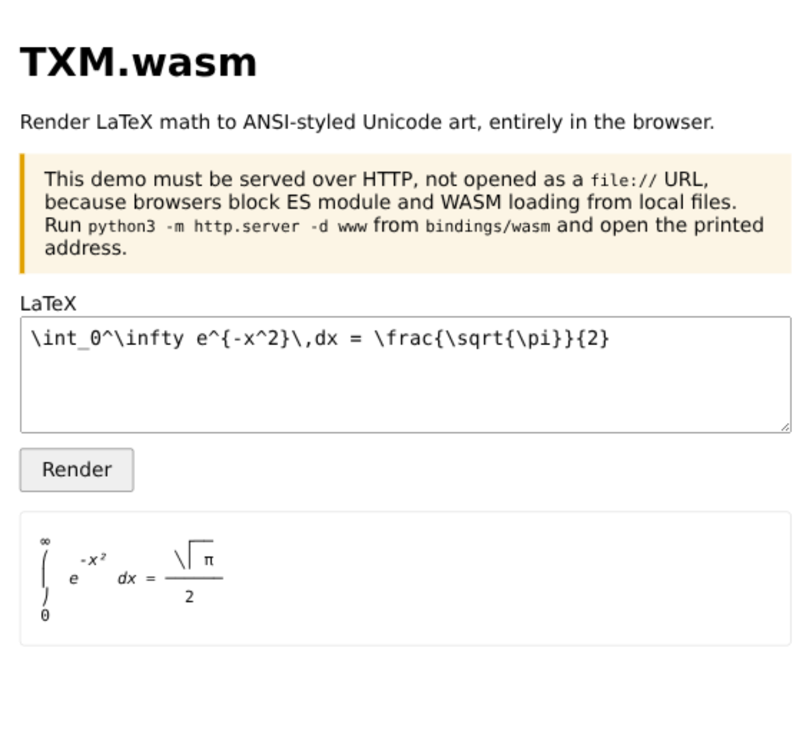

<div align="center">
  <h1>TXM.wasm</h1>
  <p>WebAssembly / JavaScript bindings for TXM.</p>
</div>

### Build

From the repository root:

```sh
rustup target add wasm32-unknown-unknown
cargo install wasm-pack
cd bindings/wasm
wasm-pack build . --target nodejs
```

### Example (Node.js)

```js
const { render } = require('./pkg/txm_wasm.js');

console.log(render('E = mc^2'));
console.log(render('\\int_0^\\infty e^{-x^2}\\,dx = \\frac{\\sqrt{\\pi}}{2}'));
```

`render` returns ANSI-styled Unicode art: the output contains SGR escape
sequences (such as `\x1b[3m...\x1b[0m`), so render it with a terminal or
strip the escapes before displaying it as plain text. If the input cannot be
parsed, `render` throws a JavaScript `Error`.

Run the smoke test after building:

```sh
node tests/smoke.mjs
```

### Demo (browser)

A small no-build demo lives in [`www/`](./www/). Build the web target into a
separate output directory so the Node `pkg/` is left untouched. These commands
run from `bindings/wasm`, which is where the build steps above leave you:

```sh
rustup target add wasm32-unknown-unknown
wasm-pack build . --target web --out-dir www/pkg
python3 -m http.server -d www
```

Open the printed address (for example <http://localhost:8000/>) and enter
LaTeX in the textarea.



> The page must be served over HTTP, not opened as a `file://` URL: browsers
> block ES module imports and WASM fetches from local files.

The integration is just `await init()` followed by `render`:

```js
import init, { render } from './pkg/txm_wasm.js';

await init();

// ansiToHtml is defined in www/main.js (see below).
const ansi = render('\\frac{1}{2}');
document.querySelector('#output').innerHTML = ansiToHtml(ansi);
```

`render` returns ANSI SGR text. The demo's ANSI-to-HTML conversion (bold,
italic, underline, and resets, with extended colors stripped) lives in
[`www/main.js`](./www/main.js); use that as the reference rather than copying
it here. Style the result with `white-space: pre` so the rendered columns line
up.

## License
- Apache License, Version 2.0 ([LICENSE-APACHE](LICENSE-APACHE))
- MIT license ([LICENSE-MIT](LICENSE-MIT))
